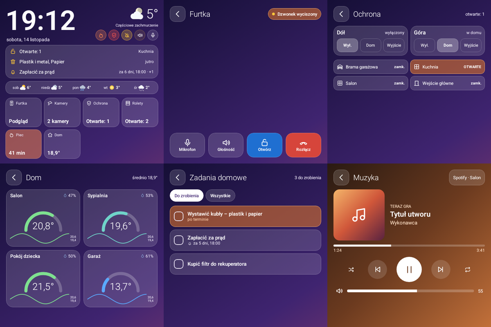

# Wallglass

A wall-panel launcher for Android touch screens (built and tested on the **Sonoff NSPanel Pro**, 480×480)
that turns them into a fast, good-looking Home Assistant control panel – no browser and no dashboard YAML.

- **Configured from Home Assistant.** A companion integration (`wallglass`) discovers each panel. You pick
  the entities in the integration's options and the panel updates live. Anything left empty is auto-discovered.
- **Native and fast.** Jetpack Compose UI with no WebView. Live state comes over the HA WebSocket API.
  Cameras play via RTSP (go2rtc) or HLS.
- **Made for the wall.** It runs as the home screen, has a clock screensaver and a dim night mode, and turns
  the screen on when the doorbell rings or a notification arrives. HA can control the screen and page.
- **Voice assistant.** “**Hej Dom**” wake word detected on the device, then any Assist pipeline you run in HA
  (local Whisper/Piper/Ollama or cloud). A smaller *lite* APK leaves the wake word out.
- **Talk to the gate.** Two-way audio with the door station through go2rtc (WebRTC, with echo cancellation).
- **Yours to style.** Six themes (Sky, Graphite, Light, Sand, Forest, Black), brightness by day and night,
  a quiet mode, and reminders from your to-do list that pop up on the panel.

> **Status: 0.2.0, early release.** The UI is currently **Polish only** (translations welcome). It runs on
> Android 8.0+ (API 26), tested on the NSPanel Pro (Android 8.1) with Home Assistant 2026.10.

## What it shows

| Screen | Entities | Notes |
|---|---|---|
| Start | `weather`, status icons, waste sensor, to-do, tiles | Bold clock, Today card (closures, waste, next task), forecast, tiles with live state |
| Gate / doorbell | `camera` + ring sensor + open action + mute switch | Live view, listen, talk back (go2rtc WebRTC), two-step “Open”, mute |
| Cameras | `camera` (many, scrolls) | go2rtc RTSP when configured, otherwise HA HLS |
| Security | `alarm_control_panel`, `binary_sensor` (door/window/garage_door/opening) | Arm/disarm modes per zone, open/closed list |
| Covers | `cover` | Position bar, up/down, “all up / all down” |
| Heating | `switch` / `input_boolean` / `climate`, `timer`, scripts/buttons, schedules | Running state, time left, +1 h, stop |
| Home (rooms) | temperature `sensor` (+ humidity) | Gauge plus 24 h history sparkline |
| To-do | `todo` | Mark done, due dates, reminders with a time |
| Waste | [Waste Collection Schedule](https://github.com/mampfes/hacs_waste_collection_schedule) sensor | 14-day calendar, colour per fraction |
| Music | `media_player` | Cover art, progress, transport, volume, player switcher |
| Assistant | Assist pipeline | “Hej Dom”, swipe up or tile |
| Notifications | `persistent_notification` with id `wallglass*` | “Done” dismisses in HA, “Remind in 1 h” snoozes |

All screens with screenshots: **[docs/screens.md](docs/screens.md)**.

## Quick start

1. **Install the app** from the [latest release](https://github.com/paweb88/wallglass/releases/latest): `wallglass-<version>.apk`, or `wallglass-<version>-lite.apk` without the wake word (see [docs/install.md](docs/install.md) for NSPanel Pro / ADB steps).
2. **Install the integration:** in HACS add this repository as a *custom repository* (type *Integration*), or copy
   `custom_components/wallglass` into your HA `config/custom_components`. Restart HA.
3. **Add it:** *Settings → Devices & services → Add integration → Wallglass*.
4. **Log in on the panel:** enter your HA address (e.g. `http://homeassistant.local:8123`) and log in on the normal HA
   login page. A dedicated non-admin HA user is recommended.
5. **Confirm the panel** that appears under *Discovered* in HA. Then open *Configure* on it to choose entities.

That's it – without any configuration the panel already auto-discovers cameras, covers, alarms, openings,
temperatures, to-do lists, media players and a waste sensor.

## Documentation

- [Installation](docs/install.md) – app, integration, NSPanel Pro specifics, updating
- [Configuration](docs/configuration.md) – integration options, `wallglass.json`, auto-discovery, gestures, wallpaper, night mode
- [Screens and entities](docs/screens.md) – what each screen shows and which entities drive it
- [Automations](docs/automations.md) – entities the integration creates, notifications, doorbell, examples
- [Voice assistant](docs/voice.md) – Assist pipeline, quiet mode, full vs lite APK, the “Hej Dom” wake word, training your own
- [Development](docs/development.md) – building, tests, screenshots, project layout, release signing

## Not yet verified

Wallglass is developed on a single panel. These parts work in tests but have not been confirmed in daily use:
- **“Hej Dom” with real voices in a room.** The accuracy figures come from held-out recorded and synthetic clips. Treat the wake word as experimental and tune it with the logcat levels (see [voice.md](docs/voice.md)).
- **The music screen** with real players (Spotify, Sonos, …).
- **Doorbell audio** (the “Listen” button). It depends on the camera stream carrying audio.
- **Talking back** through go2rtc. Audio from Home Assistant through go2rtc to a real Hikvision station and back was confirmed at the gate, and the panel's WebRTC path was tested with a simulated station. A real call from the panel's own microphone (level, echo) still needs checking.
- **Screens other than 480×480.**
- **The Light and Sand themes** on a real panel (checked in screenshots only).

Reports and PRs are welcome.

## Privacy and security

- Login uses Home Assistant's own OAuth flow. Tokens are stored in Android `EncryptedSharedPreferences`.
  The app never sees your password.
- The panel talks only to your Home Assistant (plus go2rtc if you configure RTSP or talk-back). It has no analytics and no cloud of its own.
- The wake word runs fully on the device. Audio is sent to HA only after “Hej Dom” or a tap.
- The integration's WebSocket commands only accept the HA user that registered the panel.
- Opening the gate always takes two taps.

## License

Code: [MIT](LICENSE). The bundled wake-word models may be limited to non-commercial use; see [THIRD_PARTY.md](THIRD_PARTY.md).
Not affiliated with Home Assistant, Nabu Casa or Sonoff/ITEAD.
