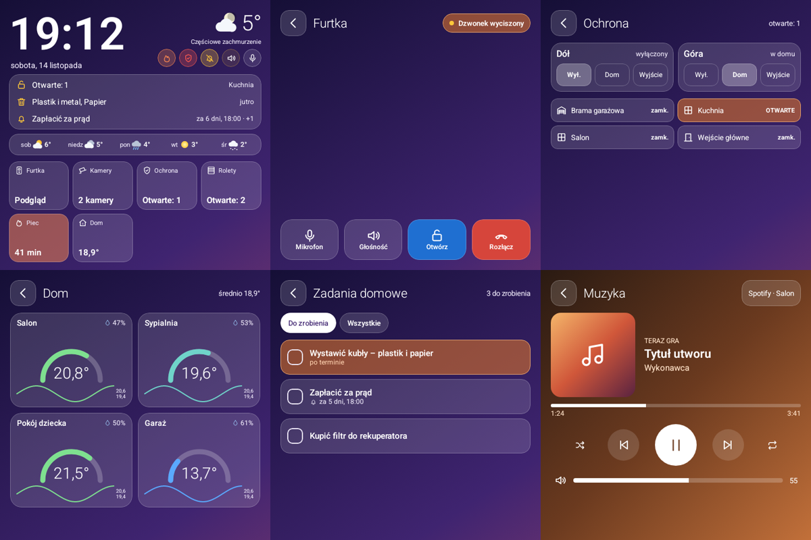

# Wallglass (po polsku)

Wallglass to aplikacja na ścienne panele z Androidem, głównie Sonoff NSPanel Pro 480×480. Zamienia panel w szybki
i ładny pulpit Home Assistanta, bez przeglądarki i bez YAML-owych dashboardów. Całość konfiguruje się w HA.

**Co potrafi**
- Ekran startowy: pogrubiony zegar, pogoda, karta „Dziś” (zamknięcia, śmieci, najbliższe zadanie), prognoza i kafle ze stanem.
- Furtka z rozmową przez go2rtc (WebRTC), kamery (RTSP z go2rtc albo HLS), ochrona, rolety, ogrzewanie, temperatury z wykresami, zadania, kalendarz śmieci i muzyka.
- Powiadomienia z HA, przypomnienia z listy zadań, wygaszacz z zegarem i przyciemniony tryb nocny.
- Sześć motywów (Niebo, Grafit, Jasny, Piasek, Las, Czerń), jasność w dzień i w nocy, tryb cichy (przycisk, ustawienia albo „Hej Dom, wycisz panel”).
- Asystent głosowy przez Assist w HA, wywoływany słowem **„Hej Dom”**, które panel rozpoznaje sam. Jak ktoś tego nie potrzebuje, jest mniejsze APK „lite” bez słowa wybudzającego.
- Własne słowo wybudzające da się wytrenować, instrukcja krok po kroku jest w [docs/voice.md](docs/voice.md#training-your-own-wake-word).
- Dla polskiego Pipera: [`tools/piper-pl`](tools/piper-pl) sprawia, że daty, godziny i temperatury są czytane z poprawną odmianą.
- Gesty: przesunięcia otwierają wybrane strony.

**Szybki start**
1. Zainstaluj APK z [najnowszego wydania](https://github.com/paweb88/wallglass/releases/latest): `wallglass-<wersja>.apk` (z „Hej Dom”) albo `wallglass-<wersja>-lite.apk` (bez, mniejsze). Na NSPanel Pro trzeba najpierw włączyć ADB przez eWeLink, opis jest w [docs/install.md](docs/install.md).
2. Dodaj integrację: w HACS dodaj to repozytorium jako „Custom repository” typu Integration. Możesz też skopiować `custom_components/wallglass` do konfiguracji HA. Potem zrestartuj HA.
3. W HA wejdź w Ustawienia → Urządzenia i usługi → Dodaj integrację → **Wallglass**.
4. Na panelu podaj adres HA i zaloguj się, najlepiej osobnym użytkownikiem bez uprawnień administratora.
5. Zatwierdź panel w HA, w sekcji „Wykryte”. W jego opcjach wybierzesz, co ma pokazywać.

Pełna dokumentacja jest po angielsku w katalogu [docs/](docs/). Interfejs aplikacji jest na razie tylko po polsku.
