# Screens and entities

Every screen is shown at the panel's native 480×480. These screenshots are rendered from sample data by the
snapshot tests (`./gradlew recordPaparazziFullDebug`).

The interface is in Polish for now.

## Start

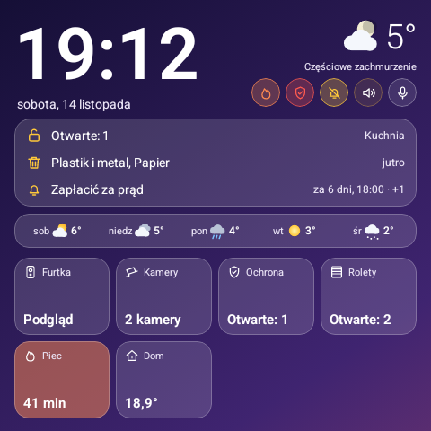 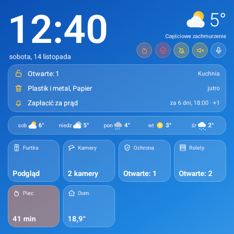

**Themes.** Pick one in the panel settings: Sky (follows the time of day), Graphite, Light, Sand, Forest and Black.
Light themes switch to Black at night and on the gate, camera and assistant pages.

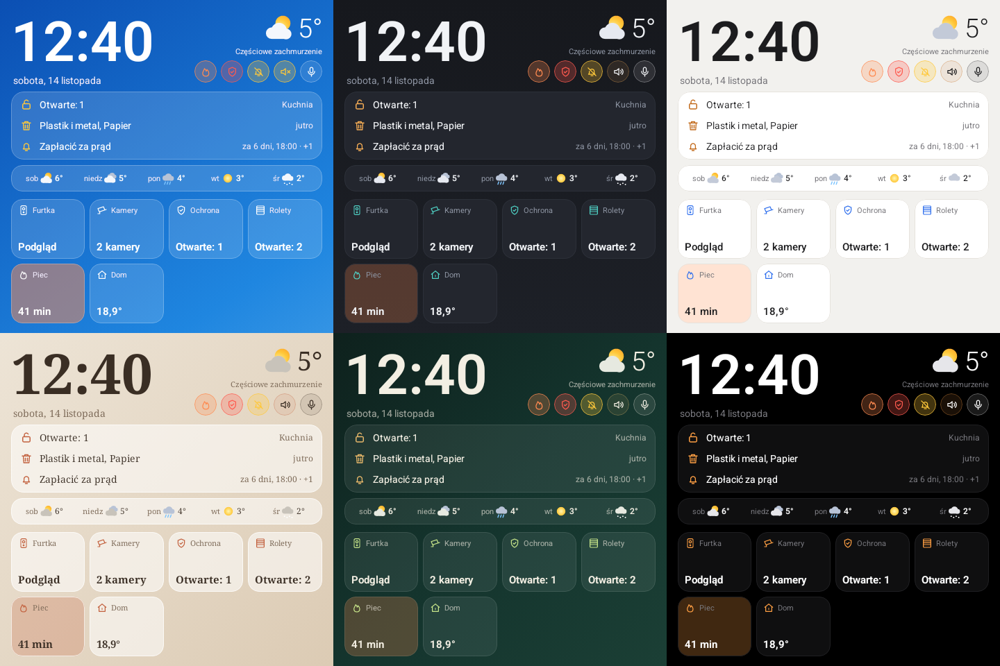

- **Clock and weather.** Current conditions (`weather`). Next to them: status icons that show only while active
  (heating on, alarm armed, doorbell muted, garage open, …; from `chips` or auto-detected), the quiet-mode button
  and a button for the assistant.
- **Today card.** One line each for closures (“All closed” or what is open), the next waste collection and the next
  task or reminder. Tap a line to open its page. Lines appear only when configured.
- **Forecast.** Five days in one line.
- **Tiles.** Each tile shows its module's state: gate, cameras, security (green when all closed), covers, heating,
  music and home (average temperature). A tile appears only when its entities exist. Hide tiles locally with a long
  press on the clock.
- Swipe up/down/left/right to open pages (see [configuration](configuration.md#gestures)).

## Gate / doorbell

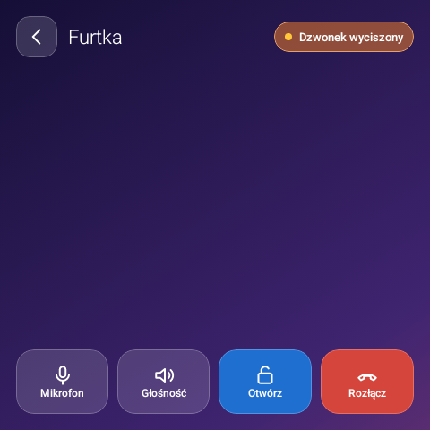

- Live stream: go2rtc RTSP when configured, otherwise HA HLS. The picture fades in on the first frame, so there is no black flash.
- **Volume** toggles listening with a timer. **Open** takes two taps and calls your script, button or lock.
  **Hang up** returns to the start screen.
- The **mute** pill in the header shows and toggles the doorbell mute entity.
- **Microphone** talks to the door station through go2rtc over WebRTC (see [configuration](configuration.md#talking-to-the-door-station)).
  Tap to start, tap again to stop. You hear the visitor over the same call. It hangs up by itself after 3 minutes or when you leave the page.
  The button is hidden when talk-back is not configured.

## Cameras

A scrolling grid of camera snapshots. Tap one for full-screen live video.
Driven by `camera` entities and the optional per-camera `rtsp`.

## Security

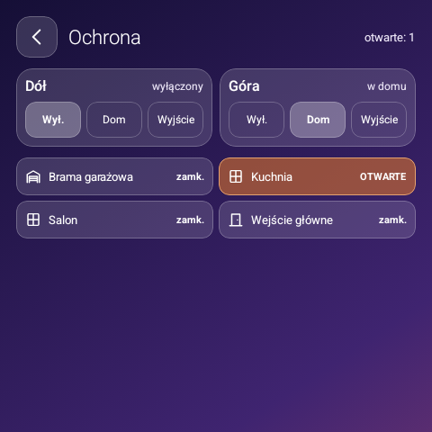

- One card per `alarm_control_panel`, with **Off / Home / Away** buttons (`alarm_disarm`, `alarm_arm_home`, `alarm_arm_away`).
- A list of `binary_sensor` openings (door, window, garage_door, opening). Open ones are highlighted.

## Covers

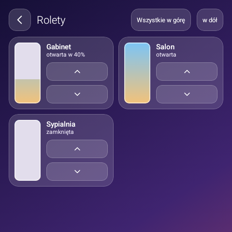

Each `cover` shows its position bar and up/down buttons. **All up / all down** is in the header.
A shared first word is stripped from names: “Rolety Salon” and “Rolety Gabinet” become “Salon” and “Gabinet”.

## Heating

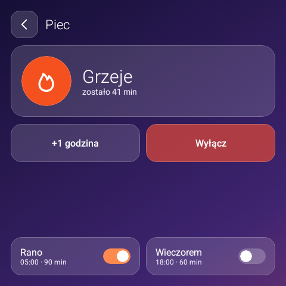

- The heating `switch`, `input_boolean` or `climate`, with the time left from the `timer`.
- **+1 hour** and **Off** call the configured actions.
- Each **schedule** is a toggle, with its time and duration.

## Home (rooms)

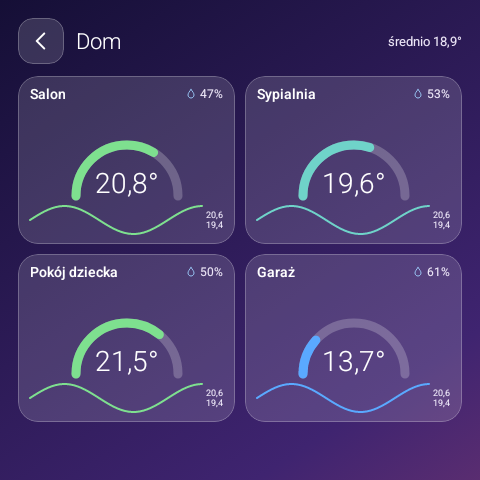

Each room shows a temperature gauge, humidity and a 24-hour history sparkline with min and max.
The history comes from the HA history API and refreshes every 10 minutes.

## To-do

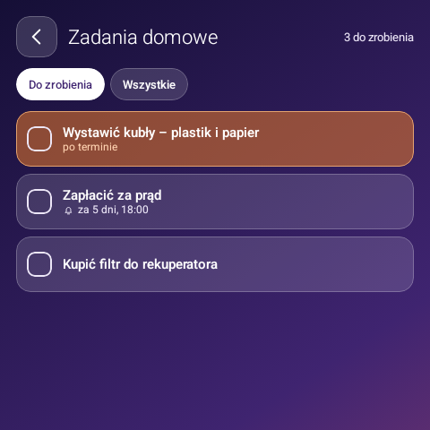

Items come from a `todo` list (`todo/item/list`). Tap one to mark it done. Due dates show as “today”, “tomorrow” or “in N days”. Items with a due **time** are
reminders: they show a bell and pop up as a card when due (see [automations](automations.md#reminders)).
There are two tabs: *To do* and *All*.

## Waste collection

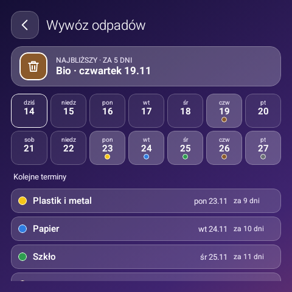

- The next collection, with a countdown.
- A two-week calendar with coloured dots for each fraction.
- A list of the following dates.
Needs a Waste Collection Schedule sensor (see [configuration](configuration.md#waste-collection)).

## Music

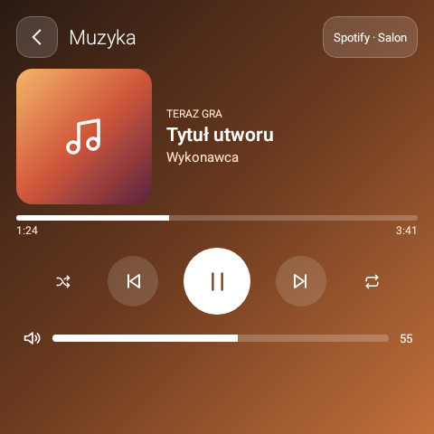

- Cover art from `entity_picture`, plus title, artist and album.
- A live progress bar.
- Shuffle, previous, play/pause, next and repeat.
- Volume: tap or drag.
- The button in the header switches between the configured `media_player`s and shows the source.

## Assistant

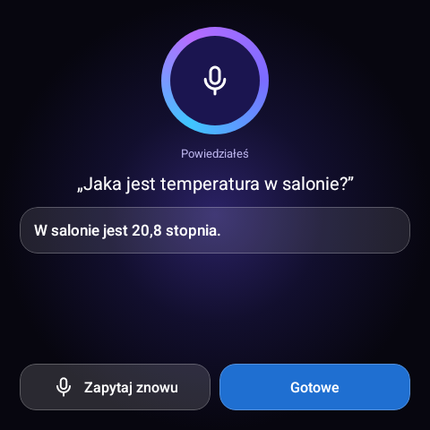

- An animated orb while listening or thinking.
- What you said and what the assistant answered.
- **Ask again** and **Done**.
See [voice.md](voice.md).

## Notifications

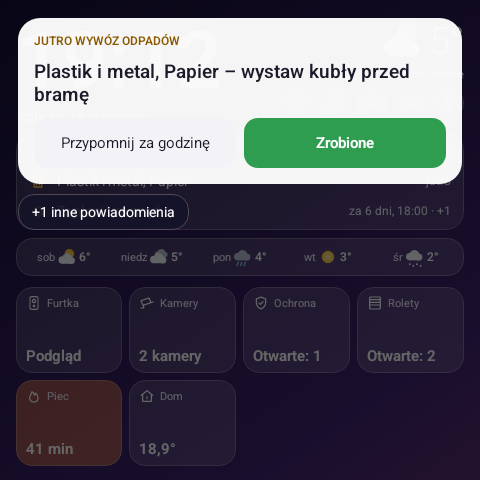

A card over any screen for `persistent_notification`s with the configured prefix. It has **Done** and **Remind in 1 h**.

## Screensaver and night

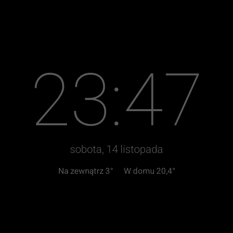

A large clock with the date and the outside and inside temperatures. At night it is very dim.

## Panel settings

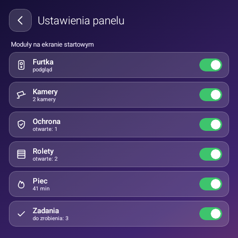

Open it with a long press on the start-screen clock.
- tiles
- wallpaper
- screensaver
- “Hej Dom” wake word
- server
- log out
